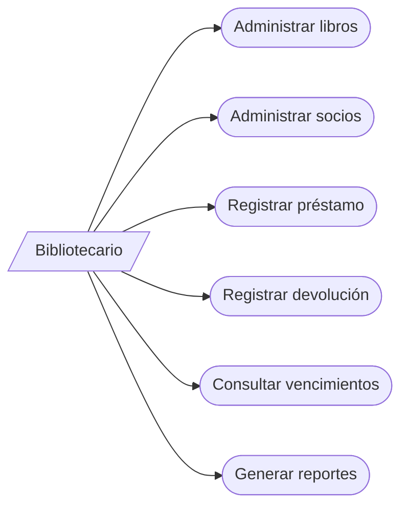
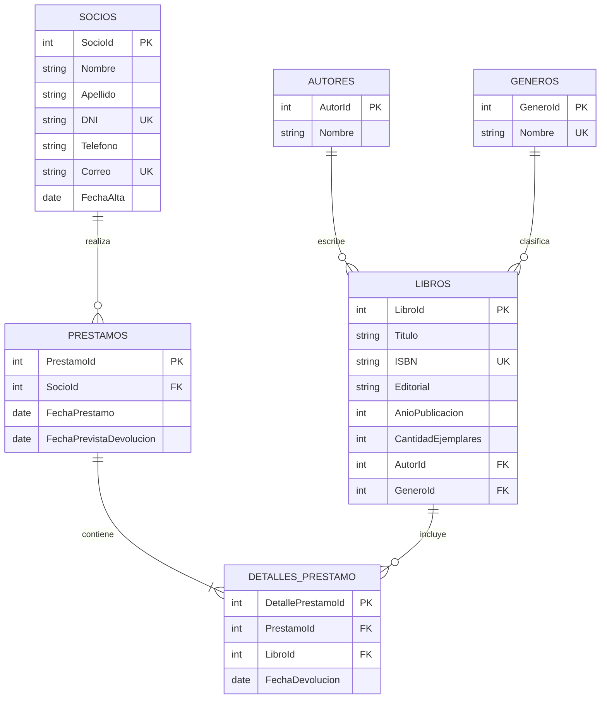

# Bookly — Sistema de Gestión de Bibliotecas

Proyecto académico para Analista en Sistemas. La entrega implementa una demostración web de gestión bibliotecaria con HTML, CSS y JavaScript, sin dependencias externas de ejecución.

## Estado real del proyecto

**Funciona en el navegador:** administración de libros y socios (alta, consulta, búsqueda, modificación y baja con confirmación); validación de campos y duplicados; préstamos, devoluciones, vencimientos y disponibilidad derivada; indicadores y actividad; historial por socio; filtros por fechas, libro y socio; exportación de reportes a CSV e impresión.

**Datos de demostración:** el primer inicio crea ejemplos de libros, socios y préstamos (incluye un préstamo vencido). Los cambios posteriores se guardan en `localStorage` de ese navegador y perfil. No hay servidor, base de datos activa ni sincronización entre usuarios o dispositivos. La sesión no tiene autenticación.

**Diseño propuesto, todavía no integrado:** [database.sql](./database.sql) contiene un esquema relacional SQLite. Esta versión no ejecuta consultas SQL ni incluye una API ASP.NET Core. Las reglas implementadas en JavaScript se ejecutan solamente en el cliente y no deben considerarse validación de seguridad del lado del servidor.

## Problema

En una biblioteca pequeña, mantener el catálogo, los datos de socios y las fechas de préstamo en registros separados dificulta localizar ejemplares, detectar demoras y conocer el historial. Bookly organiza esas operaciones en una interfaz única y calcula la disponibilidad a partir de los ejemplares registrados y los préstamos pendientes.

## Objetivos

### Objetivo general

Diseñar e implementar un sistema de gestión bibliotecaria sencillo que organice el catálogo, los socios y la circulación de ejemplares, con controles de integridad y consultas útiles para la administración.

### Objetivos específicos

- Modelar las entidades principales y sus relaciones evitando duplicaciones en el esquema relacional.
- Facilitar altas, búsquedas, modificaciones y bajas controladas de libros y socios.
- Registrar préstamos y devoluciones, aplicar límites de disponibilidad y reconocer vencimientos.
- Resumir la actividad y permitir consultar y exportar información de circulación.
- Separar presentación, lógica de interacción y modelo de persistencia para facilitar una futura migración a una API y una base de datos.

## Requisitos

### Funcionales

| ID | Requisito | Estado |
|---|---|---|
| RF-01 | Consultar estadísticas de libros, socios y préstamos activos/vencidos. | Implementado |
| RF-02 | Crear, editar, buscar y eliminar libros con título, autor, ISBN, editorial, año, género y ejemplares. | Implementado |
| RF-03 | Mostrar disponibilidad y evitar préstamos de ejemplares agotados. | Implementado |
| RF-04 | Registrar, consultar, buscar, editar y eliminar socios con DNI y correo únicos. | Implementado |
| RF-05 | Registrar préstamos con socio, libro y fechas, y controlar la devolución prevista. | Implementado |
| RF-06 | Registrar devoluciones y actualizar la disponibilidad derivada. | Implementado |
| RF-07 | Distinguir préstamos activos, vencidos y devueltos. | Implementado |
| RF-08 | Consultar el historial de circulación de un socio. | Implementado mediante el filtro de reportes por socio |
| RF-09 | Filtrar préstamos por fecha, libro y socio. | Implementado |
| RF-10 | Exportar el resultado filtrado a CSV o imprimirlo. | Implementado |
| RF-11 | Persistir cambios entre visitas en el mismo navegador. | Implementado con `localStorage`; limitado al navegador y dispositivo |
| RF-12 | Autenticar usuarios y gestionar permisos. | Pendiente; no hay autenticación |
| RF-13 | Persistir en SQLite y ofrecer acceso a través de ASP.NET Core. | Pendiente; esquema propuesto en `database.sql` |

### No funcionales

- Interfaz adaptable a pantallas de escritorio y móviles, con navegación por teclado y formularios etiquetados.
- Interfaz en español con mensajes de confirmación, éxito y validación.
- Persistencia local sin servicios externos de ejecución. La tipografía web puede descargarse de Google Fonts; sin conexión se usan fuentes alternativas.
- El prototipo no es apto para producción ni para información personal real: no tiene autenticación, autorización, API, respaldo, cifrado ni validación del lado del servidor.
- El modelo SQLite define claves, restricciones e índices; todavía no se ejecuta desde la página.

## Historias de usuario

- Como bibliotecario, quiero encontrar un libro por título, autor, ISBN o género para responder consultas rápidamente.
- Como bibliotecario, quiero registrar socios sin repetir DNI o correo para mantener un padrón confiable.
- Como bibliotecario, quiero prestar un ejemplar disponible y registrar su devolución para conocer la disponibilidad actual.
- Como bibliotecario, quiero identificar préstamos vencidos para hacer seguimiento de las devoluciones.
- Como administrador, quiero filtrar y exportar préstamos por período, título y socio para preparar informes.

## Casos de uso principales

1. **Administrar catálogo:** el bibliotecario lista, busca, agrega y edita libros; para eliminar, confirma la operación. No se permite eliminar un libro asociado a préstamos, para conservar la integridad del historial.
2. **Administrar socios:** el bibliotecario registra o modifica datos; el sistema rechaza DNI o correo duplicados. No se permite eliminar un socio asociado a préstamos del historial.
3. **Gestionar circulación:** el bibliotecario elige un socio y un libro disponible, registra las fechas y confirma. Al devolver, el sistema guarda la fecha real y libera el ejemplar.
4. **Consultar informes:** el bibliotecario aplica filtros de fecha, libro y socio, revisa los estados calculados y exporta CSV o imprime la vista.

## Modelo entidad-relación

## Tablas y relaciones

- **Autores:** identidad del autor separada del libro para no repetir sus datos.
- **Generos:** catálogo de géneros con nombre único.
- **Libros:** metadatos bibliográficos y cantidad total; referencia a un autor y un género. El ISBN es único.
- **Socios:** datos de contacto e identificación. DNI y correo son únicos.
- **Prestamos:** cabecera del préstamo: socio y fechas compartidas por los ejemplares prestados.
- **DetallesPrestamo:** ejemplares incluidos en cada préstamo y fecha real de devolución. Permite más de un libro por préstamo. La disponibilidad se deriva contando detalles aún no devueltos, sin mantener un contador duplicado.

El prototipo guarda autor y género como texto en cada libro y representa cada operación como un préstamo de un libro. Esta simplificación pertenece solo al modelo de demostración; el esquema SQL muestra la normalización propuesta para la versión persistida.

## Organización

- `index.html`: estructura de páginas, navegación y formulario modal.
- `styles.css`: estilos, componentes, adaptación responsive y reglas de impresión.
- `app.js`: datos de demostración, validación de formularios, reglas de circulación, renderizado y persistencia local.
- `database.sql`: esquema SQLite propuesto; no conectado al prototipo.
- `README.md`: análisis, requisitos, casos de uso, modelo, guía de uso y pruebas.

## Instalación y ejecución

1. Descargá o copiá la carpeta del proyecto.
2. Abrí `index.html` en un navegador moderno (Chrome, Edge o Firefox). No requiere instalación de paquetes ni servidor.
3. Navegá desde el menú lateral. Los cambios quedan guardados en el almacenamiento local del perfil del navegador.
4. Para volver a los datos iniciales, borrá los datos locales del archivo/sitio en la configuración de almacenamiento de ese navegador. Esto elimina los cambios guardados.

Los diagramas Mermaid se visualizan en lectores compatibles con Mermaid. Para inspeccionar el diseño de SQLite, abrí `database.sql` en un cliente SQLite. Ejecutarlo no conecta automáticamente la interfaz.

## Manual breve

1. **Inicio:** revisá los indicadores, el gráfico de actividad mensual, los títulos más solicitados y los últimos préstamos.
2. **Libros:** usá el buscador; agregá un título con ISBN de 10 o 13 caracteres; editá o eliminá con sus acciones. La disponibilidad se calcula descontando los préstamos no devueltos.
3. **Socios:** buscá por nombre, DNI, teléfono o correo. Registrá nombre, apellido, DNI, teléfono, correo y fecha de alta. Usá **Historial** para abrir el reporte filtrado por esa persona.
4. **Préstamos:** elegí **Registrar préstamo**, seleccioná socio y libro, y completá las fechas. Los títulos agotados no aparecen como opciones. Filtrá por estado y usá **Registrar devolución** para cerrar un préstamo.
5. **Reportes:** opcionalmente elegí fechas, libro y socio. Los filtros se aplican a la fecha del préstamo. Descargá el resultado en CSV o usá la impresión del navegador.

Los registros de demostración incluyen un préstamo vencido intencionalmente para mostrar el indicador y los filtros.

## Casos de prueba

| ID | Escenario y pasos | Resultado esperado |
|---|---|---|
| CP-01 | Abrir por primera vez `index.html`. | Se cargan datos de ejemplo, indicadores y un préstamo vencido. |
| CP-02 | Buscar un libro por parte de su autor o ISBN. | Solo se muestran coincidencias; la búsqueda no distingue mayúsculas. |
| CP-03 | Registrar un ISBN de longitud distinta de 10 y 13. | Se muestra un error y no se agrega el libro. |
| CP-04 | Registrar un libro con ISBN ya existente. | Se rechaza el duplicado y se informa al usuario. |
| CP-05 | Registrar dos socios con el mismo DNI o correo. | El segundo registro se rechaza. |
| CP-06 | Registrar un préstamo con devolución anterior al préstamo. | Se muestra un error; no se registra el préstamo. |
| CP-07 | Prestar el último ejemplar disponible. | Se registra el préstamo y la disponibilidad pasa a cero. |
| CP-08 | Intentar prestar un título sin ejemplares disponibles. | El título no puede seleccionarse y el envío también se valida. |
| CP-09 | Registrar una devolución y revisar disponibilidad e indicadores. | El préstamo queda devuelto y el ejemplar vuelve a estar disponible. |
| CP-10 | Intentar eliminar un libro o socio con préstamos devueltos o pendientes. | La eliminación se bloquea para preservar las referencias del historial. |
| CP-11 | Filtrar reportes por fechas, título y socio; descargar CSV. | El resultado respeta todos los filtros y se descarga un CSV separado por punto y coma. |
| CP-12 | Recargar la página en el mismo navegador tras hacer cambios. | Los datos modificados persisten en `localStorage`. |
| CP-13 | Abrir en una ventana móvil y usar el menú. | El diseño se adapta y la navegación lateral se abre y cierra. |

## Ampliaciones recomendadas

Implementar una API ASP.NET Core con Entity Framework Core y SQLite usando el esquema de `database.sql`; trasladar las validaciones a servicios del servidor, agregar autenticación y permisos, y crear pruebas automatizadas de negocio y de integración antes de usar datos reales.
